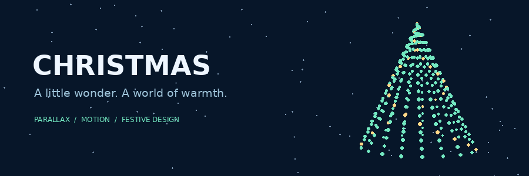

<div align="center">



# Christmas Web

A snowy village, a moonlit sky, and a little Christmas magic.


[Explore the code](index.html) · [Commit history](https://github.com/Sung-Barsan/Christmas-web/commits/main/) · [Bug-fix PR](https://github.com/Sung-Barsan/Christmas-web/pull/1)

</div>

## A festive scene in motion

Christmas Web is a static landing page built with HTML, CSS, and JavaScript. Layered illustrations create depth as you scroll through a winter village, sharing ideas, and Christmas celebrations.

| Experience | Implementation |
| --- | --- |
| Layered moon, mountains, trees, and Santa | Rellax parallax scrolling |
| Animated entrance to the Christmas scene | GSAP |
| Sections revealed during scrolling | ScrollReveal |
| Mobile navigation and section highlighting | Vanilla JavaScript |
| Snow decorations and responsive layouts | CSS animations and media queries |

The banner above is a bundled animated GIF of a rotating 3D-style tree. Its animation runs directly in GitHub's image viewer.

## Run locally

Clone the repository and serve its directory with Python 3.

```bash
git clone https://github.com/Sung-Barsan/Christmas-web.git
cd Christmas-web
python3 -m http.server 8000
```

Open [localhost:8000](http://localhost:8000) in your browser. There is no package installation or build step.

Google Fonts and Remix Icon load from external services. The animation libraries and scene artwork are included in the repository.

## Repository map

| File | Purpose |
| --- | --- |
| `index.html` | Page sections, navigation, and artwork |
| `style.css` | Layout, colors, responsive styles, and snow animations |
| `script.js` | Menu interactions, scroll state, and animation setup |
| `rellax.min.js` | Parallax library |
| `gsap.min.js` | Entrance animation library |
| `scrollreveal.min.js` | Scroll-triggered reveal library |
| `*.png` | Scene layers and decorative illustrations |
| `docs/christmas-hero.gif` | Animated README banner |

## Review status

As reviewed on November 4, 2026, the project is a static frontend with no backend, package manifest, automated test suite, or CI workflow in the repository.

[PR #1](https://github.com/Sung-Barsan/Christmas-web/pull/1) proposes fixes for seven issues covering the navigation breakpoint, keyboard access, hidden controls, section highlighting, placeholder buttons, layout overflow, and accessible social-link names. At the time of this review, the PR remains open.

JavaScript syntax, simulated navigation behavior, local asset paths, and fragment targets passed targeted checks. Visual browser verification remains outstanding because Chromium could not launch in the review environment.

## Activity and visitors

The last-commit and pull-request badges show repository activity. They do not indicate a passing build, since the repository currently has no CI workflow.

The README views badge is supplied by a third-party image counter. It measures requests to its image endpoint, may be affected by caching, and does not count unique visitors or website visits.

## Credits

Built by [Sung-Barsan](https://github.com/Sung-Barsan). Animation libraries include Rellax, GSAP, and ScrollReveal. Typography comes from Google Fonts, and icons come from Remix Icon.

